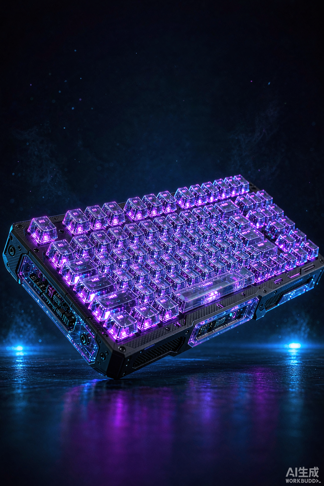
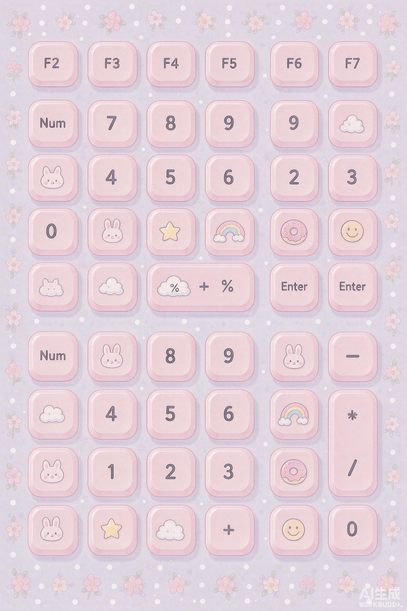

# ⌨️ KeySkin · 手机键盘壁纸提示词生成器

> 一句话描述，自动生成 **AI 图像模型直接能看懂**的手机键盘皮肤壁纸提示词。
> 小白不会写 prompt？把大白话交给 KeySkin，它替你编译成专业 Prompt。

---

## ✨ 这东西解决啥问题

做**手机 / 平板键盘皮肤壁纸**时，要出图得给 Midjourney、Stable Diffusion、即梦、可灵 这类 AI 写一段**专业的英文提示词**。新手卡在「不知道怎么写、写出来效果差」。

KeySkin 把门槛砍掉：

```
你写：「赛博朋克、霓虹蓝紫、金属质感、带 RGB 发光的手机键盘壁纸」
            ↓  KeySkin 离线编译（零依赖、零成本）
AI 出图用的 Prompt：
"A mobile phone keyboard skin, cyberpunk aesthetic with futuristic neon-city vibe,
 neon, blue, purple color scheme, made of metal, RGB backlighting,
 sculpted keycaps, grid background, theme: "…". ultra detailed, 8k product render,
 centered, clean layout, professional photography, mobile keyboard wallpaper, full-bleed art."
```

生成的 Prompt + 负面词 + 推荐比例（**适配你手机屏幕**），**复制粘贴即可出图**。

### 示例输出（由 AI 图像模型按 KeySkin 生成的提示词产出）

| 赛博朋克 · 霓虹紫 | 可爱少女 · 粉嫩 |
| --- | --- |
|  |  |

> 上图仅作效果示意；你自己跑起来后，把真实出图替换进来即可。

## ✨ 功能

- 🗣️ **大白话 → 专业 Prompt**：中文描述解析出 风格 / 颜色 / 材质 / 光效 / 键帽 / 背景 / 类型，套用英文模板
- 🎨 **风格预设**：赛博朋克、可爱少女、极简、复古、自然、国风、暗黑、科技、梦核、繁复华丽（可不选，自动判断）
- 🧠 **听得懂人话（方案 B）**：
  - **否定词**：「不要红色」「非机械」会被识别并剔除（且能区分「非常」≠「非」）
  - **同义词**：「酷炫」「小清新」「性冷淡」等口头禅也能识别成对应风格
  - **冲突检测**：「极简但花哨」「哑光又镜面」这类自相矛盾会提示并保留最先出现的那一个
- 📱 **机型比例自适应**：内置 9:16 / 9:18 / 9:19.5 / 9:20 / 3:4 / 16:9，按你的手机屏幕选，方便随时换壁纸
- 🎛️ **键盘形态自适应**：标准全宽 / 横屏 / 单手·左 / 单手·右 / 分体 / 浮窗六种形态，自动把视觉主体放进"不被键盘遮挡的安全区"（横屏自动切 16:9）。**一张壁纸通吃字母 / 数字 / 符号 / 表情 / 手写 / 九宫格等所有输入模式**——它们叠的是同一张背景
- 🔁 **多平台格式一键切换**：通用 / Midjourney / Stable Diffusion / 即梦·可灵，四种「复制即用」文本，平台语法自动适配
- 📋 **一键复制**：选好格式直接复制给对应 AI 图像模型
- 🤖 **可选 Ollama 智能润色**：本机装了 Ollama 可点「AI 润色」让提示词更细腻（没装也能正常用）
- 💾 **我的皮肤**：生成结果本地保存，随时回看
- 📦 **批量生成 + 导出 JSON**：一次提交多条描述，结果可一键导出
- 🔌 **本地 Agent 可用**：提供干净 REST API 与命令行入口，Agent 可直接调用（见下）
- 🛠️ **数据可自调**：所有词表 / 风格 / 同义词 / 冲突规则集中在 `knowledge.py`，想加风格只改这一个文件

### 📱 手机键盘模式怎么"适应"？

手机上的键盘有两层概念，KeySkin 对它们的处理不同：

- **输入模式**（显示什么键：字母 QWERTY / 数字 123 / 符号 #+= / 表情 Emoji / 九宫格拼音 / 手写 / 语音）——这些模式都**叠在同一张背景壁纸上**（键盘 App 用半透明方式浮在壁纸上），所以**一张壁纸就能通吃所有输入模式**，无需为每种输入法单独生成。
- **形态模式**（键盘在屏幕上怎么摆：标准全宽 / 横屏 / 单手左 / 单手右 / 分体 / 浮窗）——这才是壁纸真正要适配的：不同形态覆盖屏幕的区域不同（全宽约 45%、单手约 30% 一侧、分体中间留空、浮窗只占小窗）。KeySkin 会据此自动把视觉主体放进**不被键盘遮挡的安全区**，并在 prompt 里写明构图；横屏形态自动切换到 16:9。

---

## 🚀 快速开始

```bash
pip install -r requirements.txt      # 或 python -m pip install -r requirements.txt
python app.py
```

浏览器打开 http://localhost:5000 即可。

> 可选：安装 [Ollama](https://ollama.com) 并 `ollama pull llama3.2` 解锁「AI 润色」功能。无 Ollama 时其余功能完全正常。

---

## 💻 命令行 / 本地 Agent 调用（无需起服务）

```bash
# 生成并打印「通用」格式
python keyskin.py "赛博朋克霓虹紫的手机键盘壁纸，透明质感，RGB灯"

# 指定风格 + 指定平台格式
python keyskin.py "国风红金手机键盘" -s chinese -f midjourney

# 指定机型比例（适配不同手机屏幕，如 9:19.5 / 9:20）
python keyskin.py "极简手机键盘壁纸" -r 9:19.5

# 指定键盘形态（standard / landscape / onehand_left / onehand_right / split / floating）
# 横屏会切换到 16:9 构图；分体 / 单手会让主体避开键盘遮挡区
python keyskin.py "赛博朋克手机键盘壁纸" -m split

# 输出完整 JSON（含四种格式与结构化属性），方便程序解析
python keyskin.py "可爱粉色键盘" --json

# 从文件批量生成（每行一条描述）
python keyskin.py --batch descs.txt -f jimeng

# 直接拉起 Web 服务（等价于 python app.py）
python keyskin.py --serve
```

作为 **Python 库** 调用（Agent 可直接 import，不需要 HTTP）：

```python
from skin_engine import generate
r = generate("赛博朋克手机键盘壁纸，霓虹紫，RGB灯", ratio="9:19.5")
print(r["outputs"]["midjourney"])   # 直接拿 MJ 格式的复制即用文本
print(r["zh"])                      # 中文解读：工具「听懂」了什么
```

---

## 🔌 API（给本地 Agent 用）

| 方法 | 路径 | 说明 |
| --- | --- | --- |
| GET | `/api/styles` | 列出可选风格预设 + 可选机型比例 `ratios` + 可选键盘形态 `keyboard_modes`（含中文名与覆盖区域）+ `default_ratio` / `default_mode` |
| POST | `/api/generate` | 核心：`{"description": "...", "style": "cyberpunk?", "ratio": "9:19.5?", "mode": "split?"}` → 返回 prompt / negative_prompt / params / 中文解读 / **outputs（四格式）** |
| POST | `/api/batch` | 批量：`{"descriptions": [...], "style": "?", "ratio": "?", "mode": "?"}` → 逐条生成并入库，返回结果列表 |
| GET | `/api/export` | 导出全部历史为 JSON（供下载 / Agent 批量消费） |
| POST | `/api/enhance` | 可选：用本机 Ollama 模型润色草稿 |
| GET | `/api/models` | 列出本机 Ollama 模型 |
| GET / POST / DELETE | `/api/skins` , `/api/skins/<id>` | 历史皮肤的增删查 |

`/api/generate` 返回示例：
```json
{
  "ok": true,
  "prompt": "A mobile phone keyboard skin, cyberpunk aesthetic...",
  "negative_prompt": "blurry, low resolution, ...",
  "params": { "aspect_ratio": "9:19.5", "style_en": "cyberpunk", "style_zh": "赛博朋克" },
  "attributes": { "warnings": [], "style_zh": "赛博朋克", "color_zh": "霓虹、蓝、紫", "...": "..." },
  "zh": "风格：赛博朋克　颜色：霓虹、蓝、紫　材质：metal ...",
  "outputs": {
    "universal": "A mobile phone keyboard skin... [负面词] ... [比例] 9:19.5",
    "midjourney": "A mobile phone keyboard skin... --ar 9:19.5 --style raw\n--no ...",
    "stable_diffusion": "A mobile phone keyboard skin...\nNegative prompt: ...\nSteps: 30, ...",
    "jimeng": "A mobile phone keyboard skin...\n比例 9:19.5　|　负面词：..."
  }
}
```

---

## 📁 项目结构

```
KeySkin/
├── app.py              # Flask 后端 + SQLite + 可选 Ollama 润色
├── skin_engine.py      # 提示词编译引擎（解析/冲突消解/四格式渲染，离线零依赖）
├── knowledge.py        # 【数据层】词表 / 风格预设 / 同义词 / 否定词 / 冲突规则 / 机型比例（用户可自调）
├── keyskin.py          # 命令行 / 本地 Agent 入口
├── requirements.txt
├── static/             # 前端（原生 HTML/CSS/JS，无构建）
│   ├── index.html  style.css  app.js
├── assets/             # README 示例图
├── tests/test_engine.py
├── keyskin.db          # 自动生成的本地数据库（已 gitignore）
├── LICENSE  README.md  .gitignore
```

---

## 🧪 测试

```bash
python -m pip install pytest
python -m pytest tests -q
```

测试覆盖：引擎解析（否定词 / 同义词 / 冲突消解 / 黄金≠黄 等边界）、四种格式输出、机型比例、REST API、批量与导出、命令行入口。

## 🗺️ 后续可扩展

- [x] 多种输出格式（MJ / SD / 即梦 各自适配）
- [x] 否定词 / 同义词 / 冲突检测
- [x] 机型比例自适应
- [x] 导出 / 导入皮肤方案（JSON）、批量生成
- [ ] 接入真实出图 API（需用户自备 key，默认走本地零成本方案）
- [ ] 各风格的示例皮肤画廊（小白一键套用）

## 📄 开源协议

[MIT](./LICENSE)
